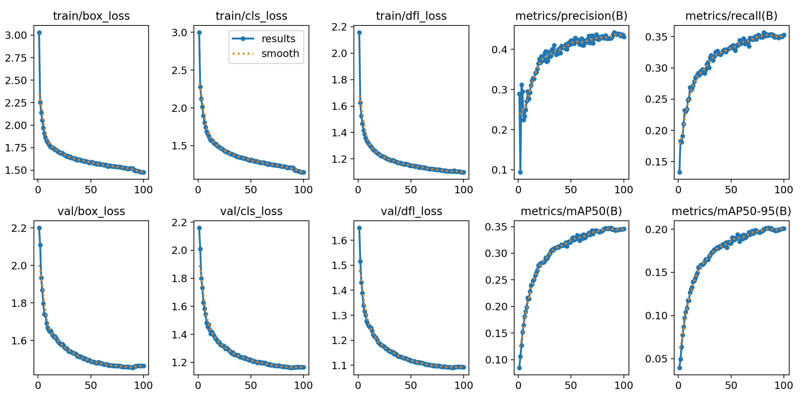
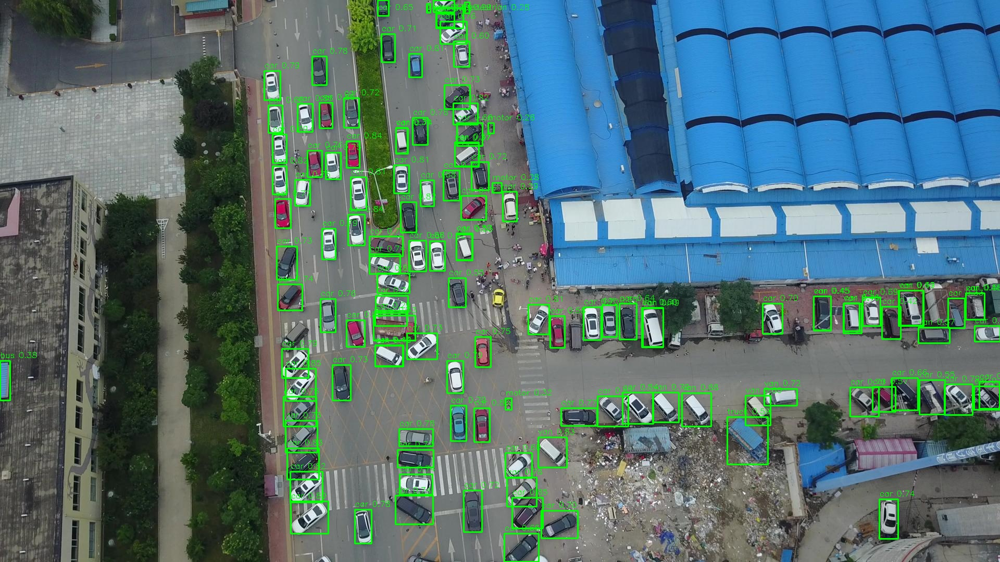
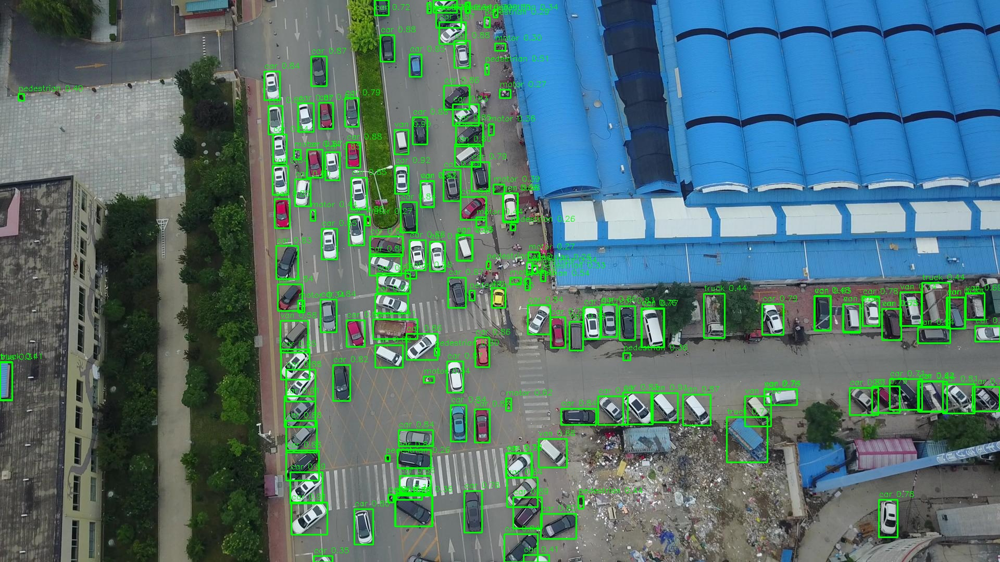
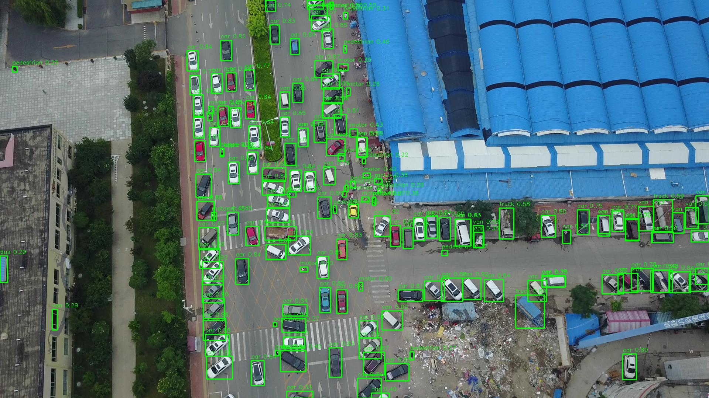

# 基于 YOLOv8 的 VisDrone 小目标模型与切片推理改进实验报告

## 摘要

本实验面向 VisDrone 航拍场景中的密集小目标检测问题，按“先改进网络结构，再优化推理流程”的顺序开展实验。首先在已有轻量化 Final 模型基础上加入 P2 自适应加权融合（P2-AWF），完成 100 epoch 训练及整图验证；随后围绕切片策略、跨切片重复框抑制、小框误检过滤和整图—切片双路融合开展推理实验。

切片后处理消融沿用最初 Final 权重，以便单独分析推理策略；最后再将训练好的 P2-AWF 权重接入锁定的 P8 推理方案，形成最终组合模型 **Final-P2-AWF + P8**。

最终方案在 VisDrone val 上取得：

- mAP50：**0.4146**；
- mAP50-95：**0.2408**；
- Precision：**0.4854**；
- Recall：**0.4262**；
- F1：**0.4465**；
- 平均总耗时：**155.86 ms/图**；
- P95 总耗时：**196.61 ms/图**；
- 平均预测框数：**228.0 个/图**；
- 模型参数量：**1,546,195（约 1.5462M）**。

该方案在本次记录的 Final 系列实验中取得最高 mAP50 和 mAP50-95。与 Final + P8 相比，P2-AWF + P8 的 Precision 略低，平均及 P95 时延更高，因此最终选择属于精度优先的方案，不代表速度占优。

---

## 1. 项目背景与实验目标

VisDrone 图像具有分辨率较高、目标尺寸小、目标密集、遮挡严重和尺度变化大的特点。若直接将整张原图缩放到较小的模型输入尺寸，小目标会因缩放而损失大量像素；采用切片推理可以放大小目标，但也会产生跨切片重复框、边界截断框以及低置信度小框过多等问题。

本实验的主要目标为：

1. 在 Final 的 P2 融合点加入自适应分支权重，检验其对小目标检测的影响；
2. 验证切片推理相较整图推理是否有效；
3. 减少相邻切片对同一目标产生的重复检测框；
4. 减少低置信度、极小面积误检，同时保护真实小目标；
5. 找到合适的 `merge-iou`、IoS 阈值和切片尺寸；
6. 通过整图分支补充切片分支的全局上下文；
7. 在精度、召回率、模型规模与推理速度之间选出最终方案。

本实验分为网络结构训练和推理阶段优化两部分。P2-AWF 改变了 Final 的 P2 融合模块并重新训练权重；后续 P1–P8 切片实验则使用最初 Final 权重，单独评估推理和后处理变化。

---

## 2. 实验环境、数据和统一评估协议

### 2.1 实验对象

| 项目                | 内容                                    |
| ------------------- | --------------------------------------- |
| 数据集              | VisDrone2019-DET                        |
| 类别数              | 10 类                                   |
| Baseline 参数量     | 3,012,798（约 3.0128M）                 |
| Final 参数量        | 1,546,192（约 1.5462M）                 |
| Final-P2-AWF 参数量 | 1,546,195（约 1.5462M）                 |
| 推理框架            | 项目自带 Ultralytics 8.1.20             |
| 结构训练脚本        | `coursework/train_fair_coursework.py` |
| 整图评估脚本        | `coursework/evaluate_coursework.py`   |
| 切片推理脚本        | `coursework/sliced_inference.py`      |
| 切片评估脚本        | `coursework/evaluate_sliced.py`       |

Final 模型的参数量比 Baseline 少 1,466,606，降幅约 **48.69%**。P2-AWF 在 Final 基础上仅增加 3 个可学习融合参数。切片、NMS、IoS、小框过滤和双路推理本身不会改变权重参数量。

### 2.2 训练设置与环境差异

Baseline、Final 和 Final-P2-AWF 的正式训练均记录为 100 epochs、batch=4、imgsz=640、seed=42、YOLOv8n COCO 预训练初始化、SGD、AMP 和 deterministic 模式。训练记录显示，Baseline 与 Final 在 NVIDIA RTX 4090、Python 3.10.21 环境训练

此外，Baseline/Final 与 P2-AWF 的 VisDrone YAML SHA256 不同。哈希不同可能来自路径等非语义差异，也可能代表数据配置变化；在确认文件内容完全一致前，结构收益应视为本次实验观察，而非严格排除所有混杂因素后的因果结论。

### 2.3 正式切片实验的统一设置

除每项消融明确指定的变量外，正式实验主要固定为：

```text
candidate conf：0.001
draw-conf：0.25
predict-iou：0.70
max-det：300
overlap：0.25
切片分支 imgsz：640
```

其中，`conf=0.001` 用于保留计算 AP 所需的完整置信度排序；`draw-conf=0.25` 仅决定可视化图片中绘制哪些框，不改变预测 JSON 和 mAP。

### 2.4 评估流程

网络结构与整图模型比较由 `evaluate_coursework.py` 使用标准 Ultralytics validator 完成。切片实验先由 `sliced_inference.py` 生成原图坐标系下的预测 JSON，再由 `evaluate_sliced.py` 读取预测结果和 YOLO 标签计算 mAP50、mAP50-95、Precision、Recall、F1 及各类别 AP。切片实验平均耗时来自 `summary.json`，P95 来自 `timing.csv` 中逐图 `total_ms` 的第 95 百分位数。

---

## 3. 模型结构调整：Final-P2-AWF

### 3.1 Final 基线结构

原 Final 已包含 P2 小目标检测头、P2/P3/P4 检测输出、跨尺度特征融合和 CBAM。Final 的 P2 融合节点将三路特征直接拼接：浅层高分辨率细节、主干 P2 特征以及上采样至 P2 尺度的 P3 语义特征。原结构为：

```text
三路 P2 特征 -> Concat -> C2fCBAMv2 -> P2 检测输出
```

本次结构改进不再重复增加 P2 检测头或叠加新的注意力模块，而是只调整这一个 P2 融合节点。

### 3.2 自适应加权融合模块

在 Final 的 P2 融合位置加入 `AdaptiveWeightedConcat`。该模块为三路输入各学习一个标量权重，按权重缩放后再拼接，后续的 `C2fCBAMv2` 和 Detect 结构保持不变：

```text
原 Final：三路 P2 特征 -> Concat -> C2fCBAMv2 -> Detect(P2, P3, P4)
改进模型：三路 P2 特征 -> 自适应分支加权 -> Concat -> C2fCBAMv2 -> Detect(P2, P3, P4)
```

计算形式为 `w_i = 3 × softmax(a)_i`，`y = Concat(w_1*x_1, w_2*x_2, w_3*x_3)`。三个可学习 logits 初值为 0，因此初始时每路权重为 1，前向输出与普通 Concat 等价；训练后由损失梯度学习各分支的重要性。输出通道与特征图形状不变，新增参数为 3 个。

实现涉及 `ultralytics/nn/modules/conv.py`、模块导出与模型解析注册、`model_configs/yolov8-p2_woP5_sandwich_CBAM_p2awf.yaml` 和训练入口 `coursework/train_fair_coursework.py`。最终 YAML 只把 Final 的 P2 Concat 节点换成 AdaptiveWeightedConcat。

### 3.3 训练过程和收敛情况

图中蓝线为逐 epoch 记录值，橙色虚线为平滑趋势。训练损失和验证损失整体下降，验证 mAP50 与 mAP50-95 后期继续上升并逐步趋于平稳。



Final-P2-AWF 使用 `yolov8n.pt` 预训练权重初始化，训练 100 epochs，batch=4、imgsz=640、seed=42、SGD、AMP 开启。训练完成 100/100 epochs，参数量 1,546,195。训练曲线中 train box/cls/dfl loss 与 val box/cls/dfl loss 总体下降，mAP50 和 mAP50-95 持续上升至训练末段，没有出现明显的“训练损失继续下降、验证损失持续上升且 mAP 下滑”的过拟合形态。

### 3.4 Final-P2-AWF 标准整图 val 结果

Final 和 Final-P2-AWF 均以 imgsz=640 在同一评估脚本下进行标准整图评估，不启用切片。结果如下：

| 模型                   | Precision |   Recall |    mAP50 | mAP50-95 |    参数量 |   平均总耗时 |
| ---------------------- | --------: | -------: | -------: | -------: | --------: | -----------: |
| Final，整图 640        |  0.434474 | 0.354187 | 0.344563 | 0.200319 | 1,546,192 | 22.865 ms/图 |
| Final-P2-AWF，整图 640 |  0.426331 | 0.355634 | 0.348288 | 0.202384 | 1,546,195 | 23.083 ms/图 |

与 Final 相比，P2-AWF 的 mAP50 增加 0.003724，mAP50-95 增加 0.002065，Recall 增加 0.001447；Precision 降低 0.008142。参数仅增加 3 个，平均总耗时增加约 0.218 ms/图。整图结果显示 P2-AWF 有小幅 mAP 与 Recall 改善，但 Precision 略降；这本身不足以证明综合优势，后续需在同一切片融合方案下验证。

---

## 4. Final 模型切片与后处理逐步改进

### 4.1 E0/E1：建立模型与切片控制组

- **E0**：Baseline 模型使用初始切片和后处理参数，用于建立切片控制组；
- **E1**：仅将权重换为 Final，其他参数与 E0 一致，用于观察轻量化 Final 模型的原始切片表现。

E0/E1 使用相同的初始切片协议：`tile-size=640`、`imgsz=640`、`overlap=0.25`、`merge-iou=0.50`、`IoS=0.80`，未开启边界感知和小框过滤。E0 与 E1 的唯一区别是权重文件。

E0 的 mAP50=0.385748、mAP50-95=0.222775；E1 的 mAP50=0.363660、mAP50-95=0.201257。E0 的参数量为 3,012,798，E1 的参数量为 1,546,192；两者分别使用 256.04 ms/图和 220.36 ms/图的平均总耗时。E0/E1 的 Precision、Recall、F1 和平均框数已由对应新评估文件读取并填入第 5.1 节。本节 P1–P8 的切片及后处理消融使用原始 Final 权重，不是 Final-P2-AWF 权重。

### 4.2 P1：分离评估阈值与显示阈值

P1 只将绘图阈值设为 `draw-conf=0.25`，正式候选阈值仍为 `conf=0.001`。这一阶段解决的是“正式 AP 推理图片显示大量低分小框”的可读性问题。

P1 不改变预测 JSON，因此理论上应与 E1 具有相同 mAP。当前 `p1_draw_conf025` 同样是零预测占位结果，不能将 mAP=0 解释为性能下降。P1 的结论是：**绘图阈值只改善展示效果，不构成检测精度改进。**

### 4.3 P2：加入边界感知的跨切片 NMS

普通 class-aware NMS 只依据类别、置信度和框间 IoU 处理重复框，无法区分完整目标框和切片边缘的截断框。P2 为每个切片框记录其来源及到切片边缘的距离；同类别候选发生冲突时，优先保留距离切片边缘更远、更完整的框。

P2 相较原始 Final + IoS：

- mAP50：0.363724 → 0.365059；
- mAP50-95：0.201386 → 0.204743；
- 平均耗时：214.859 → 193.450 ms/图。

结果表明，利用切片边界信息能够改善跨切片合并质量，并降低整体后处理耗时。

### 4.4 P3：加入小框—置信度联合过滤

P3 在 P2 基础上增加小框过滤，但不直接删除所有小框。只有候选框同时满足下列条件时才删除：

```text
box_area < 32 且 confidence < 0.10
```

这种联合规则旨在过滤极小且低置信度的误检，同时保护 VisDrone 中真实的小行人、小车辆。P3 将平均框数由 P2 的 279.1 个/图降低到 273.6 个/图，mAP50-95 由 0.204743 小幅提高到 0.204784，说明该过滤没有明显损伤整体精度。

### 4.5 P4：消融跨切片 `merge-iou`

P4 保持 P3 的边界感知与小框过滤不变，只测试 `merge-iou=0.35、0.50、0.65`。较低的 `merge-iou` 会更积极地合并重叠框，较高阈值则保留更多候选。

实验结果显示，`merge-iou=0.35` 同时取得三组中最高的 mAP50、mAP50-95、Precision、Recall 和最低平均耗时，因此将其作为后续实验的固定值。

### 4.6 P5：消融 IoS 包含框阈值

IoS（Intersection over Smaller）用于识别一个框大部分被另一个框包含的情况，适合处理切片边缘产生的部分截断框。P5 固定 `merge-iou=0.50`，分别测试 IoS=0.70、0.80、0.90。

三组差异较小：IoS=0.70 的 mAP50-95 略高，但 Recall 略低；IoS=0.80 在精度、召回与保留候选数量之间较为均衡。结合 P4 的整体结果，后续保留 **IoS=0.80**，并使用更优的 `merge-iou=0.35`。

### 4.7 P6：验证收益来自模型还是后处理

P6 将与 P3 相同的后处理应用到 Baseline 模型。结果为 mAP50=0.388872、mAP50-95=0.227500，说明后处理本身能够产生显著收益，也说明模型结构与后处理存在交互：不能把 P6 的指标写成 Final 模型结果。

与此同时，Baseline 有 3.0128M 参数，约为 Final 的 1.95 倍。后续仍以轻量化 Final 为主体，并通过切片尺寸和双路融合弥补精度。

### 4.8 切片尺寸消融：T512、T640、T960、T1280

在 Final、`imgsz=640` 和完整 P4 后处理固定时，依次测试 512、640、960 和 1280 切片。

- T512 每图平均需要 7.801 个切片，重复区域和计算开销最大，精度最低；
- T640 即 P4 控制组，每图平均 5.186 个切片；
- T960 每图平均 1.918 个切片，mAP50-95 提升至 0.228157，同时平均耗时下降至 78.435 ms；
- T1280 继续扩大上下文后，目标在送入 `imgsz=640` 时缩小更多，mAP50-95 和 Recall 均低于 T960。

因此切片尺寸锁定为 **960**，不继续测试 T1536 或进行无目标的宽范围扫描。

### 4.9 单 tile 对照：验证切片是否有效

为了避免不同评估器或不同后处理造成不公平比较，实验使用同一个推理脚本和评估脚本，将 `tile-size` 设为 10000，使每张原图只产生一个 tile。

严格的“单 tile + P4 后处理”结果为 mAP50-95=0.210059，低于 T960 的 0.228157；Recall 为 0.347514，低于 T960 的 0.397448。该对照证明：**提升并非仅来自评估方法或后处理，合理切片本身确实有效。**

### 4.10 P7：T960 切片 + 640 整图融合

P7 在 T960 切片分支之外，对整张原图以 `full-imgsz=640` 额外推理一次。切片框映射回原图后与整图框拼接，再统一执行 class-aware NMS、IoS、小框过滤和 `max-det=300`。

P7 的 Recall 从 T960 的 0.397448 小幅提高到 0.400269，但 mAP50-95 从 0.228157 降至 0.225931，平均耗时增加到 108.814 ms。因此，640 整图分支所保留的全局信息不足，不能抵消额外候选和融合开销。

### 4.11 P8：T960 切片 + 960 整图融合

P8 只把整图分支的 `full-imgsz` 从 640 提升到 960，切片分支和所有后处理参数保持不变。较大的整图输入保留了更多全局目标细节，同时 T960 切片分支继续负责小目标局部信息。

P8 相较 T960：

- mAP50：0.394435 → 0.406984，提升 0.012550；
- mAP50-95：0.228157 → 0.233970，提升 0.005812；
- Precision：0.484643 → 0.489103，提升 0.004460；
- Recall：0.397448 → 0.423840，提升 0.026392；
- F1：0.428827 → 0.446069，提升 0.017243。

代价是平均耗时由 78.435 增至 104.310 ms/图，P95 由 102.457 增至 132.458 ms/图。就原始 Final 的切片推理阶段而言，P8 的四项核心指标优于 T960 与 P7，因此将 P8 固定为后续 P2-AWF 权重的推理基线。本段结论仅针对原始 Final 权重。

---

## 5. 全部实验结果

### 5.1 E0–P6 主线实验结果

| 实验         | 模型与改动              |              mAP50 |           mAP50-95 |          Precision |             Recall |                 F1 |       平均耗时 ms |            P95 ms |       平均框数/图 | 结论                             |
| ------------ | ----------------------- | -----------------: | -----------------: | -----------------: | -----------------: | -----------------: | ----------------: | ----------------: | ----------------: | -------------------------------- |
| E0           | Baseline 初始切片控制   |           0.385748 |           0.222775 |           0.468811 |           0.408033 |           0.425239 |           256.035 |           405.567 |           285.538 | 新传入的有效 E0 控制结果         |
| E1           | Final 初始切片          |           0.363660 |           0.201257 |           0.438872 |           0.404765 |           0.409887 |           220.361 |           332.299 |           278.942 | 新传入的有效 E1 原始结果         |
| 原始有效控制 | Final + IoS=0.80        |           0.363724 |           0.201386 |           0.438993 |           0.404746 |           0.409950 |           214.859 |           316.126 |           278.916 | 原始 Final 有效参照              |
| P1           | 仅 `draw-conf=0.25`   |       与E1理论相同 |       与E1理论相同 |                 — |                 — |                 — |                — |                — |                — | 只改善可视化；未作为独立精度结果 |
| P2           | 边界感知 NMS + IoS      |           0.365059 |           0.204743 |           0.442366 |           0.401249 |           0.410034 |           193.450 |           264.506 |           279.113 | 减少跨切片边界重复框             |
| P3           | P2 + 小框—置信度过滤   |           0.364982 |           0.204784 |           0.442366 |           0.401249 |           0.410034 |           192.815 |           263.579 |           273.622 | 减少低分极小框，精度基本不受损   |
| P4-0.35      | P3 + `merge-iou=0.35` | **0.366603** | **0.205618** |           0.444317 | **0.404127** | **0.413232** | **150.850** | **205.206** | **264.387** | P4最优，后续固定0.35             |
| P4-0.50      | P3 + `merge-iou=0.50` |           0.364982 |           0.204784 |           0.442366 |           0.401249 |           0.410034 |           187.897 |           257.837 |           273.622 | 不采用                           |
| P4-0.65      | P3 + `merge-iou=0.65` |           0.362566 |           0.204149 |           0.441729 |           0.398633 |           0.407503 |           261.964 |           363.541 |           280.109 | 重复框保留更多，精度和速度均较差 |
| P5-0.70      | P3 + IoS=0.70           | **0.365186** | **0.205043** | **0.444923** |           0.400462 | **0.411052** |           186.586 |           256.786 |           268.376 | P5中mAP略高                      |
| P5-0.80      | P3 + IoS=0.80           |           0.364982 |           0.204784 |           0.442366 | **0.401249** |           0.410034 | **185.330** | **253.726** |           273.622 | 均衡阈值，后续保留               |
| P5-0.90      | P3 + IoS=0.90           |           0.364695 |           0.204766 |           0.442146 |           0.399847 |           0.408702 |           188.667 |           259.520 |           276.883 | 不采用                           |
| P6           | Baseline + P3后处理     |           0.388872 |           0.227500 |           0.464249 |           0.412223 |           0.427294 |           195.650 |           284.866 |           282.869 | 证明后处理有效，但模型参数更多   |

说明：P4 与 P5 分别是不同的单变量消融。最终后续组合采用 P4 选出的 `merge-iou=0.35` 与预设的 IoS=0.80，不应把 P5-0.70 的数值直接视为最终组合结果。

### 5.2 切片尺寸与整图对照结果

| 实验        | tile-size |              mAP50 |           mAP50-95 |          Precision |             Recall |                 F1 | 平均切片数/图 | 平均框数/图 |      平均耗时 ms |           P95 ms |
| ----------- | --------: | -----------------: | -----------------: | -----------------: | -----------------: | -----------------: | ------------: | ----------: | ---------------: | ---------------: |
| T512        |       512 |           0.343111 |           0.185878 |           0.418685 |           0.396712 |           0.394444 |         7.801 |     286.682 |          232.219 |          300.928 |
| T640（P4）  |       640 |           0.366603 |           0.205618 |           0.444317 |           0.404127 |           0.413232 |         5.186 |     264.387 |          150.850 |          205.206 |
| T960        |       960 | **0.394435** | **0.228157** | **0.484643** | **0.397448** | **0.428827** |         1.918 |     199.068 | **78.435** |          102.457 |
| T1280       |      1280 |           0.369900 |           0.215345 |           0.482766 |           0.359495 |           0.403639 |         1.779 |     170.797 |          107.845 |          135.304 |
| 单tile + P4 |     10000 |           0.361968 |           0.210059 |           0.476428 |           0.347514 |           0.392707 |         1.000 |     154.416 |           83.138 | **98.836** |
|             |           |                    |                    |                    |                    |                    |               |             |                  |                  |


### 5.3 双路融合结果

| 实验 | 切片分支            | 整图分支       |              mAP50 |           mAP50-95 |          Precision |             Recall |                 F1 |      平均耗时 ms |            P95 ms | 平均框数/图 |
| ---- | ------------------- | -------------- | -----------------: | -----------------: | -----------------: | -----------------: | -----------------: | ---------------: | ----------------: | ----------: |
| T960 | tile=960，imgsz=640 | 无             |           0.394435 |           0.228157 |           0.484643 |           0.397448 |           0.428827 | **78.435** | **102.457** |     199.068 |
| P7   | tile=960，imgsz=640 | full-imgsz=640 |           0.393089 |           0.225931 |           0.481351 |           0.400269 |           0.428939 |          108.814 |           161.324 |     230.633 |
| P8   | tile=960，imgsz=640 | full-imgsz=960 | **0.406984** | **0.233970** | **0.489103** | **0.423840** | **0.446069** |          104.310 |           132.458 |     230.142 |

### 5.4 原 Final + P8 各类别结果

| 类别            | GT数量 | 预测数量 | Precision | Recall |     F1 |   AP50 | AP50-95 |
| --------------- | -----: | -------: | --------: | -----: | -----: | -----: | ------: |
| pedestrian      |  8,844 |   36,524 |    0.5422 | 0.5341 | 0.5381 | 0.5278 |  0.2379 |
| people          |  5,125 |    9,946 |    0.6272 | 0.3339 | 0.4358 | 0.4173 |  0.1594 |
| bicycle         |  1,287 |    8,611 |    0.2637 | 0.1671 | 0.2045 | 0.1241 |  0.0487 |
| car             | 14,064 |   39,449 |    0.6928 | 0.8524 | 0.7644 | 0.8423 |  0.5945 |
| van             |  1,975 |    3,870 |    0.4987 | 0.4805 | 0.4894 | 0.4578 |  0.3313 |
| truck           |    750 |    3,408 |    0.4255 | 0.3680 | 0.3947 | 0.3063 |  0.1867 |
| tricycle        |  1,045 |    3,632 |    0.4303 | 0.2670 | 0.3295 | 0.2528 |  0.1396 |
| awning-tricycle |    532 |    1,480 |    0.3175 | 0.1823 | 0.2316 | 0.1482 |  0.0897 |
| bus             |    251 |      678 |    0.5481 | 0.5179 | 0.5326 | 0.4915 |  0.3354 |
| motor           |  4,886 |   18,520 |    0.5450 | 0.5352 | 0.5400 | 0.5018 |  0.2165 |

汽车类表现最好，AP50-95 为 0.5945；自行车和带棚三轮车仍是较困难类别，这与其目标尺寸小、样本外观变化大及遮挡严重有关。

---

## 6. 原 Final 切片方案与原 Final + P8 的比较

本节保留切片阶段的历史比较：以有效的“原 Final + IoS=0.80”作为切片参照，与同一原 Final 权重的 P8 结果比较。这里的 P8 是后续 P2-AWF 结构实验之前得到的推理基准，不是本报告最终组合模型。

| 指标        | 原始 Final + IoS |    最终 P8 |    绝对变化 | 相对变化 |
| ----------- | ---------------: | ---------: | ----------: | -------: |
| mAP50       |         0.363724 |   0.406984 |   +0.043260 |  +11.89% |
| mAP50-95    |         0.201386 |   0.233970 |   +0.032584 |  +16.18% |
| Precision   |         0.438993 |   0.489103 |   +0.050110 |  +11.41% |
| Recall      |         0.404746 |   0.423840 |   +0.019094 |   +4.72% |
| F1          |         0.409950 |   0.446069 |   +0.036119 |   +8.81% |
| 平均总耗时  |       214.859 ms | 104.310 ms | -110.549 ms |  -51.45% |
| 平均框数/图 |          278.916 |    230.142 |     -48.774 |  -17.49% |
| 参数量      |        1,546,192 |  1,546,192 |           0 |       0% |

结果说明，在原 Final 权重上，P8 相较早期 Final 切片基准提高了检测精度与召回率，并通过 T960 减少平均切片数和冗余框，使平均总耗时低于该早期切片方案。

需要同时说明：相较于只运行 T960 切片的方案，原 Final P8 因增加整图分支而使平均耗时增加约 33.0%，P95 增加约 29.3%。T960 是速度优先备选；原 Final P8 是本次结构改进前的推理基准。

---

## 7. 最终组合：Final-P2-AWF + P8

在 P2-AWF 完成 100 epoch 训练后，将其权重接入已经锁定的 P8 推理流程。P8 的切片、整图分支和后处理参数不变，只替换模型权重。最终组合模型在 548 张 VisDrone val 上的结果如下：

| 模型与推理方式    | Precision |   Recall |    mAP50 | mAP50-95 |       F1 |    参数量 | 平均总耗时 ms/图 |  P95 ms | 平均框数/图 |
| ----------------- | --------: | -------: | -------: | -------: | -------: | --------: | ---------------: | ------: | ----------: |
| 原 Final + P8     |  0.489103 | 0.423840 | 0.406984 | 0.233970 | 0.446069 | 1,546,192 |          104.310 | 132.458 |     230.142 |
| Final-P2-AWF + P8 |  0.485420 | 0.426186 | 0.414646 | 0.240821 | 0.446477 | 1,546,195 |          155.857 | 196.606 |     227.998 |

P2-AWF + P8 相较原 Final + P8：mAP50 增加 0.007662（约 1.88%），mAP50-95 增加 0.006851（约 2.93%），Recall 增加 0.002346；Precision 下降 0.003683，F1 仅增加 0.000408。参数量只增加 3 个。平均总耗时增加 51.546 ms/图（约 49.42%），P95 增加 64.148 ms（约 48.43%）。因此本报告按用户确定的精度优先标准，将 Final-P2-AWF + P8 选为 val 上的最终候选，同时保留明显的速度代价，不宣称它在所有指标上都优于原 Final + P8。

P2-AWF + P8 的数据来自 `runs/07_p8_final_vs_p2awf/final_p2awf_p8/`；原 Final + P8 的对照结果来自 `runs/cloud2/sliced_val/p8_full960/`。

### 7.1 P2-AWF + P8 各类别结果

| 类别            | GT数量 | 预测数量 | Precision | Recall |     F1 |   AP50 | AP50-95 |
| --------------- | -----: | -------: | --------: | -----: | -----: | -----: | ------: |
| pedestrian      |  8,844 |   36,987 |    0.5178 | 0.5386 | 0.5280 | 0.5289 |  0.2404 |
| people          |  5,125 |   10,613 |    0.5949 | 0.3483 | 0.4394 | 0.4069 |  0.1567 |
| bicycle         |  1,287 |    9,172 |    0.2495 | 0.1849 | 0.2124 | 0.1296 |  0.0493 |
| car             | 14,064 |   38,204 |    0.6983 | 0.8542 | 0.7685 | 0.8443 |  0.5967 |
| van             |  1,975 |    3,652 |    0.5040 | 0.4668 | 0.4847 | 0.4490 |  0.3299 |
| truck           |    750 |    3,179 |    0.4058 | 0.3760 | 0.3903 | 0.3020 |  0.1843 |
| tricycle        |  1,045 |    2,924 |    0.4497 | 0.2612 | 0.3305 | 0.2701 |  0.1481 |
| awning-tricycle |    532 |    1,180 |    0.3149 | 0.1729 | 0.2232 | 0.1640 |  0.1053 |
| bus             |    251 |      660 |    0.5698 | 0.5179 | 0.5426 | 0.5354 |  0.3763 |
| motor           |  4,886 |   18,372 |    0.5494 | 0.5409 | 0.5451 | 0.5165 |  0.2213 |

P2-AWF + P8 在 pedestrian、car、motor 等类别上保持较高 AP；bicycle 与 awning-tricycle 仍是较难类别。类别指标来自本地 `evaluation/per_class.csv`，完整总体指标和预测数量见该实验目录下的 `metrics.json` 与 `summary.json`。

### 7.2 最终网络和 P8 推理配置

网络结构调整只发生在 Final 的 P2 融合节点。三个分支的权重由训练学习，其他 Final 主干、检测头和 P8 推理配置保持不变。

```text
模型权重：Final-P2-AWF best.pt
参数量：1,546,195

切片分支：
  tile-size=960
  imgsz=640
  overlap=0.25

整图分支：
  full-image-pass=true
  full-imgsz=960
  full-conf=0.001
  full-max-det=300

统一推理与融合：
  conf=0.001
  draw-conf=0.25
  predict-iou=0.70
  merge-iou=0.35
  ios-threshold=0.80
  boundary-aware=true
  edge-margin=32
  small-filter=true
  small-area=32
  small-conf=0.10
  max-det=300
```

P8 的实际处理顺序为：

1. 生成 960×960、重叠率 25% 的切片；
2. 每个切片以 `imgsz=640` 输入 Final-P2-AWF 模型；
3. 将切片框映射回原图坐标；
4. 将整张原图以 `full-imgsz=960` 再推理一次；
5. 合并两路原图坐标候选框；
6. 按类别执行边界感知 NMS，`merge-iou=0.35`；
7. 执行同类别 IoS=0.80 包含框抑制；
8. 删除面积小于 32 且置信度低于 0.10 的候选；
9. 按置信度保留最多 300 个最终框；
10. 保存预测 JSON，并以 `draw-conf=0.25` 生成展示图片。

---

## 8. 原 Final 与原 Final + P8 预测图对比

以下图片是结构改进前的原始 Final 与原始 Final + P8 样例，用于展示切片和双路融合的推理差异，不代表 Final-P2-AWF + P8 的预测图。

原始 Final



原始 Final + P8



Final-P2-AWF + P8



### 8.1 主要结论

1. 将 AP 候选阈值与绘图阈值分离是必要的；高绘图阈值可以改善展示效果，但不能被解释为 mAP 提升。
2. 边界感知 NMS 能利用切片来源信息，更合理地处理完整框和边界截断框。
3. 小框—置信度联合过滤比单纯按面积删除小框更安全，能够减少低分极小误检而不明显损伤真实小目标。
4. `merge-iou=0.35` 是本次 P4 消融中的最优值；IoS=0.80 作为均衡配置保留。
5. 切片大小并非越小越好。T512 产生过多切片和重复区域；T1280 又使目标在 `imgsz=640` 输入中缩小。T960 在当前数据和硬件上形成最佳折中。
6. 严格的单 tile 对照低于 T960，证明合理切片确实有效，而不是评估口径差异造成的假象。
7. 640 整图分支的 P7 没有带来稳定收益；将整图输入提高到 960 后，P8 同时提升 mAP、Precision、Recall 和 F1。
8. 在原始 Final 权重的切片实验中，P8 优于 T960 和 P7；后续结构实验再将 P2-AWF 与 P8 组合。
9. 综合当前 val 结果，最终候选为 Final-P2-AWF + P8。该选择以 mAP50、mAP50-95 和 Recall 为主，同时记录其 Precision 略低、推理延迟较高的取舍。

### 8.2 局限性

1. Final-P2-AWF + P8 的平均时延为 155.857 ms/图、P95 为 196.606 ms，高于原始 Final + P8 的 104.310 ms/图和 132.458 ms；部署时需评估实时性要求。
2. bicycle、awning-tricycle 等类别的 AP 仍较低，说明极小目标、遮挡与类别外观变化仍是主要难点。

---

## 9. 最终结论

本实验按“Final 网络复现—P2 自适应加权融合结构训练—原 Final 切片与后处理消融—P8 双路融合—P2-AWF 权重接入 P8”的顺序完成模型和推理改进。最终选定 **Final-P2-AWF + P8** 作为本次 val 上的精度优先方案，mAP50=0.4146、mAP50-95=0.2408、Precision=0.4854、Recall=0.4262，参数量 1,546,195。相较原 Final + P8，mAP50 与 mAP50-95 更高，Recall 略高，Precision 略低；平均耗时和 P95 时延明显增加。

因此，本项目最终方案正式锁定为：

> **Final-P2-AWF + P8：在 Final 的 P2 融合节点加入自适应分支加权，并采用 T960 切片（imgsz=640）+ 整图 960 分支 + 边界感知 class-aware NMS（merge-iou=0.35）+ IoS=0.80 + 小框—置信度联合过滤。**
